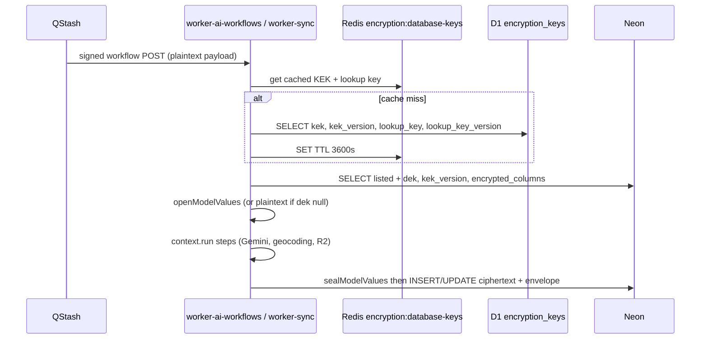
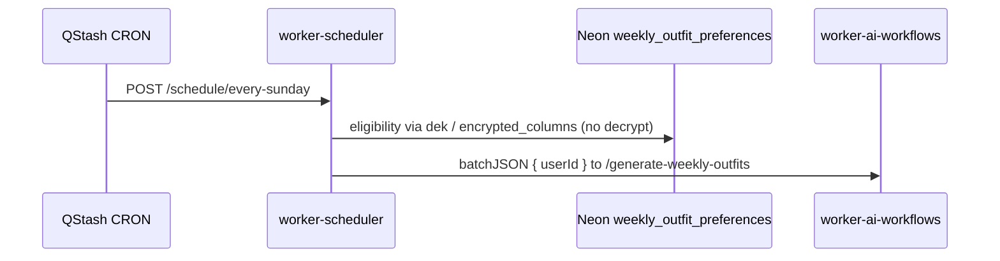

## Context

See `proposal.md` for why. SkyDIIV web v2.0.0 already ships envelope encryption in `web/app/lib/field-encryption.ts` and a D1/Redis key loader in `web/app/lib/kek-store.ts`. The shared Neon schema already has `dek`, `kek_version`, `encrypted_columns`, `lookup_columns`, and `users.email_lookup`. This repo still talks to Neon with raw postgres.js in `lib/db` repositories and treats every column as plaintext.

Workers are independent Node 22 projects (not a pnpm workspace). Each copies shared helpers rather than importing a package. Cloudflare Workers already enable `nodejs_compat`. Workflows keep using `serveMany` (last path segment; keys cannot contain `/`) and `createWorkflow` + `context.run` steps. Repositories stay the DB boundary. QStash payloads and Zod workflow input stay plaintext.

Worker URLs remain origin-only; callers append the path. No new workflow keys, outbox events, or product Redis keys.

## Goals / Non-Goals

**Goals:**

- Byte-identical envelope with web so a row written by a worker decrypts in Prisma and a row written by web decrypts in a worker.
- Encrypt and decrypt only at the SQL repository boundary. Workflow steps, prompts, geocoding, R2, and QStash keep seeing plaintext.
- Dual-read `dek IS NULL` as plaintext; seal the full listed set on the next listed write.
- Scheduler eligibility that does not decrypt preference rows.
- Same D1 table and Redis cache key as web.

**Non-Goals:**

- Design-level exclusions beyond the proposal: no Prisma client extension (workers stay on postgres.js), no D1 binding (HTTP API matches web), no shared `packages/` workspace.

## Decisions

### Copy web’s crypto modules per app, call them from repositories

Port `field-encryption.ts`, `local-encryption-keys.ts`, and `kek-store.ts` into:

- `apps/worker-ai-workflows/src/lib/field-encryption/`
- `apps/worker-sync/src/lib/field-encryption/`

Keep Prisma-style field names inside `sealModelValues` / `openModelValues` (`imageUrl`, `firstName`, …) so the copy stays aligned with web. Repositories map snake_case SQL rows to those names at the boundary.

Do not put encrypt/decrypt inside `context.run` steps. `Sql*Repository` methods SELECT `id`, `dek`, `kek_version`, `encrypted_columns` with listed columns, decrypt before returning, and seal before INSERT/UPDATE.

Rejected: a new `packages/` workspace. Observability already chose per-app copies; introducing a workspace is a separate architectural change. Drift risk is mitigated by porting web’s unit tests (golden ciphertext / HMAC vectors) into both apps.

Rejected: SubtleCrypto-only rewrite. `nodejs_compat` plus a direct port of `node:crypto` `createCipheriv('aes-256-gcm')` preserves the web layout. If Workers runtime rejects that API, fall back to SubtleCrypto AES-GCM with the same nonce||ciphertext||tag packing — tests must still pass the web vectors.

### Key loading matches web’s HTTP + Redis adapter

`createKekStore()` infers the adapter from existing `DEPLOYMENT_ENVIRONMENT` (already in wrangler `[vars]` / `.dev.vars`). There is no `ENCRYPTION_KEY_SOURCE`.

| `DEPLOYMENT_ENVIRONMENT` | Behavior |
|---|---|
| `production` | D1. Cloudflare D1 HTTP `POST /accounts/{account_id}/d1/database/{database_id}/query` with SQL `SELECT kek, kek_version, lookup_key, lookup_key_version FROM encryption_keys`. Cache JSON rows in Redis key `encryption:database-keys` for 3600 seconds. |
| `staging` | Same D1 path as production, so staging workers can decrypt rows web staging sealed. |
| `local` or unset | Fixed keys from `local-encryption-keys.ts` (same base64 as web: KEK `32×0x11`, lookup `32×0x22`, version `1`). No D1/Redis. Vitest leaves this unset. |

Current keys: highest `kek_version`, then highest `lookup_key_version`. Reads use `kekByVersion.get(row.kek_version)` and fail closed on unknown version.

Reuse each app’s existing Redis helper (`lib/cache/redis.ts` or equivalent). This cache is not a product invalidation key and MUST NOT go through shopping-suggestions / weekly-outfits cache helpers.

Rejected: a D1 binding on the worker. Web already speaks the HTTP API; a second access path would diverge on env and caching.

### Writes always assign the row id first, then re-seal the listed set

AAD is `table\0column\0rowId`. Repositories that INSERT must `randomUUID()` before `sealModelValues`, then persist that id.

On UPDATE of any listed column:

1. SELECT current listed columns plus envelope metadata.
2. If `dek` is null, treat stored listed values as plaintext.
3. Else unwrap DEK with `kekByVersion[kek_version]` and `openModelValues`.
4. Merge the patch. `sealModelValues` generates a **new** DEK for the whole listed set (web behavior).
5. UPDATE ciphertext, `dek`, `kek_version`, `encrypted_columns`.

Concrete repository changes in `worker-ai-workflows`:

| Repository | Change |
|---|---|
| `users.repository.ts` | SELECT envelope columns; decrypt names |
| `preferences.repository.ts` | Decrypt `location`, `routine_description` |
| `shopping-suggestions-preferences.repository.ts` | Decrypt sizes and gender |
| `wardrobe.repository.ts` | Decrypt `image_url`; leave `title` / tag names plaintext |
| `wardrobe-panorama.repository.ts` | Seal `content` on insert/update; decrypt on `findById` |
| `llm-interactions.repository.ts` | Allocate id, seal `prompt` / `response` (`client_prompt` null omitted) |
| `weekly-outfits.repository.ts` | `updateOutfitImageUrl` re-seals `outfits.image_url`; INSERT still leaves image null / `dek` null |
| `feedbacks-automatic-thrifting.repository.ts` | Decrypt `reason` |
| `summaries-feedbacks-automatic-thrifting.repository.ts` | Decrypt on read; replace `ON CONFLICT … SET summary = EXCLUDED.summary` and `SET summary = ''` with load → seal → UPDATE so empty string is ciphertext |

`worker-sync`: same seal/open on `wardrobe-panorama.repository.ts` and `llm-interactions.repository.ts`. `weekly-outfits.repository.ts` stays plaintext.

`json_search` copies of gender/sizes stay plaintext JSON (web does not seal that column). Outbox payloads stay plaintext.

### Scheduler eligibility uses envelope metadata, not decrypt

`SqlUsersRepository.findUsersWithOutfitPreferences` becomes:

```sql
SELECT user_id
FROM weekly_outfit_preferences
WHERE
  location IS NOT NULL
  AND routine_description IS NOT NULL
  AND (
    (
      dek IS NULL
      AND location <> ''
      AND routine_description <> ''
    )
    OR (
      dek IS NOT NULL
      AND encrypted_columns @> ARRAY['location', 'routine_description']::text[]
    )
  )
```

Assumption (recorded): web stores unset location/routine as NULL, not empty string. A sealed empty string would still appear in `encrypted_columns` and would qualify; that matches “null listed values are omitted.” The scheduler does not load KEK secrets.

Sunday flow `weekly-outfits` still batchJSON `{ userId }` to `{WORKER_AI_WORKFLOWS_URL}/generate-weekly-outfits`. Worker URL stays origin-only.

Rejected: decrypting every preference row in the scheduler. Eligibility is a set query; decrypt would pull KEK into an app that otherwise does not touch listed plaintext.

### Env, secrets, and docs

Worker runtime secrets (GitHub Environments `staging` / `production` → `wrangler secret bulk`, never `[vars]`):

- `CLOUDFLARE_ACCOUNT_ID`
- `CLOUDFLARE_D1_ENCRYPTION_DATABASE_ID`
- `CLOUDFLARE_D1_API_TOKEN`

Non-secret `[vars]`: keep existing `DEPLOYMENT_ENVIRONMENT` (`production` in default `[vars]`, `staging` in `[env.staging.vars]`, `local` in `.dev.vars`). Do not add `ENCRYPTION_KEY_SOURCE`. Do not put KEK material in `[vars]` or commit it. Local keys are public test vectors, documented as such.

Document in each affected app: `docs/FIELD_ENCRYPTION.md` + README link. Scheduler README eligibility bullet MUST describe the `encrypted_columns` filter. Workflow docs that list DB columns (`WEEKLY_OUTFITS_WORKFLOW.md`, `WARDROBE_PANORAMA_WORKFLOW.md`, `GENERATE_SEARCH_TERMS_PRODUCTS_SCRAPING.md`, `SYNC_LANGUAGE_WORKFLOW.md`) MUST note which columns are sealed at rest.

No new QStash, outbox, or worker URL.





## Risks / Trade-offs

- [Per-app copies of `field-encryption.ts` drift from web] → Port web’s vector tests into both workers. Any later web envelope change is a paired follow-up.
- [Worker writes plaintext after web has sealed the row] → Ship this change before (or with) encrypted writes to worker-owned tables: `llm_interactions`, `wardrobe_panorama.content`, `summaries_feedbacks_automatic_thrifting.summary`, `outfits.image_url`.
- [node:crypto AES-GCM missing in Workers] → Prove with a Worker-side unit test; SubtleCrypto fallback must keep the same packed layout.
- [Redis serves a removed KEK for up to 1 hour] → Accepted; rotation is out of scope (same as web).
- [Scheduler treats sealed empty-string location as opted-in] → Accepted under the NULL-not-empty-string assumption; document it.
- [Summary `ON CONFLICT` CAS races] → Keep the `updated_at` / `outdated` CASE in SQL; only `summary` and envelope columns are rewritten from the sealed payload.
- [PII in logs after decrypt] → Existing OTEL denylist still forbids email, prompts, and images on spans; do not log decrypted names, location, or summary text.

## Migration Plan

1. Implement crypto + repository changes and docs in `worker-ai-workflows` and `worker-sync`; eligibility SQL + docs in `worker-scheduler`.
2. Add D1 secrets to GitHub Environments `staging` and `production`. Key source follows `DEPLOYMENT_ENVIRONMENT` (already `production` / `staging` / `local`).
3. Deploy staging workers, then production. Prefer deploying backstage **before** or **with** web encrypted writes to worker-owned tables.
4. Dual-read covers existing plaintext rows. No backfill.

Rollback: redeploy the previous worker builds. Safe only while this version has not written ciphertext to worker-owned rows, or while web dual-read still handles those rows (web already does). Do not roll back web’s Prisma migration while ciphertext exists. Scheduler rollback restores `location <> ''`, which mis-classifies sealed rows as opted-in — avoid rolling back the scheduler while sealed preference rows exist.

No feature flag. Dual-read is the compatibility path.

## Open Questions

None. Envelope layout, D1 table shape, Redis cache key, and listed columns are defined by SkyDIIV web v2.0.0.
