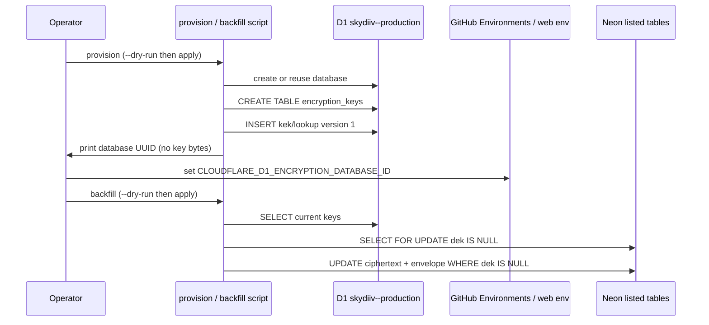

## Context

See `proposal.md` for why. Specs live in `specs/scripts/provision-encryption-keys-and-backfill/spec.md`.

SkyDIIV web v2.0.0 already ships the envelope in `web/app/lib/field-encryption.ts` and the D1 reader in `web/app/lib/kek-store.ts`. Backstage workers already dual-read `dek IS NULL` and load that same table over the D1 HTTP API. PostgreSQL database already has `dek`, `kek_version`, `encrypted_columns`, `lookup_columns`, and `users.email_lookup`. Existing rows are still plaintext.

This repo already runs one-off Python ≥ 3.12 scripts via uv (`scripts/202610_backfill_clothing_item_colors_and_sizes/`, `scripts/utils/db.py`). There is no worker URL, wrangler `[vars]`, or GitHub Environment secret *code* change in this design. After provision, operators still set `CLOUDFLARE_D1_ENCRYPTION_DATABASE_ID` on web and on worker GitHub Environments (those secret names already exist). Worker URLs stay origin-only and are unused here.

## Goals / Non-Goals

**Goals:**

- Port web `sealModelValues` semantics into a Python operator script (byte layout, AAD, email/birth-date canonicalization, `email_lookup`, actor columns).
- Rewrite `created_by` / `updated_by` from a stored email to that email’s `email_lookup` HMAC before sealing, except on `access_keys`, `domains`, `events`, and `outbox_events`. Workers keep writing their app names.
- Provision D1 `skydiiv--production` + `encryption_keys` through the Cloudflare HTTP API, not Wrangler CLI.
- Split provision and backfill so operators can set D1 secrets on web/workers before any Neon row is sealed.
- Reuse `scripts/utils/db.py` and `scripts/utils/logger.py`.

**Non-Goals:**

- Do not restate proposal non-goals (no key rotation, no worker/Prisma/QStash changes, no local test vectors in D1).
- Do not add pytest to older scripts or Vitest to workers for this change.
- Do not invalidate Redis `encryption:database-keys`; an empty D1 never caches (kek-store throws before write). After keys exist, the next web/worker load fills the cache.

## Decisions

### 1. Dated Python package with two subcommands

Copy `scripts/202610_backfill_clothing_item_colors_and_sizes/` layout: `scripts/202610_provision_encryption_keys_and_backfill/` with `pyproject.toml` (Python ≥ 3.12, `psycopg[binary]`, `python-dotenv`, `cryptography`, `httpx`, `pytest`), `__main__.py`, `.env.example`, `README.md`, gitignored `output.txt` / `.venv`.

Subcommands:

| Command | Effect |
|---|---|
| `provision` | Create/reuse D1 `skydiiv--production`, `CREATE TABLE IF NOT EXISTS encryption_keys`, insert version 1 if empty, print UUID |
| `backfill` | Load current keys from D1, seal Neon rows with `dek IS NULL` |

Shared flags: `--dry-run`, `--env`. Backfill also gets `--limit N` (rows per table) and optional `--table <name>` so operators can sample `users` before the rest.

`created_by` on the D1 row: `script:202610_provision_encryption_keys_and_backfill`. Neon rows have no `updated_by` on these tables; do not invent one.

- Alternative considered: one command that provisions and backfills in a single process. Rejected — web and workers fail closed on unknown `kek_version`. Operators MUST copy the printed UUID into secrets *before* ciphertext exists.
- Alternative considered: TypeScript script that imports worker `field-encryption.ts`. Rejected — one-off scripts in this repo are Python via uv; workers are not a package.

### 2. Cloudflare HTTP API, one database name, DDL copied from web

Talk to `https://api.cloudflare.com/client/v4/accounts/{account_id}/d1/database` with `CLOUDFLARE_ACCOUNT_ID` + `CLOUDFLARE_D1_API_TOKEN` (D1 edit). No Wrangler binary.

| Step | API |
|---|---|
| Find by name | `GET .../d1/database` and match `name === skydiiv--production` |
| Create | `POST .../d1/database` body `{ "name": "skydiiv--production" }` |
| SQL | `POST .../d1/database/{id}/query` body `{ "sql": "..." }` (same path workers already use) |

Default name `skydiiv--production` matches web changelog v2.0.0/v2.0.1 and worker specs. Staging and production workers already share that table so staging can open rows web staging sealed. Do not create a second D1 for staging.

`CREATE TABLE IF NOT EXISTS` MUST match web `scripts/database-encryption-keys.sql`:

```sql
CREATE TABLE IF NOT EXISTS encryption_keys (
  kek TEXT NOT NULL,
  kek_version INTEGER NOT NULL,
  lookup_key TEXT NOT NULL,
  lookup_key_version INTEGER NOT NULL,
  created_at TEXT NOT NULL,
  created_by TEXT NOT NULL,
  UNIQUE (kek, kek_version, lookup_key, lookup_key_version)
);
```

If `CLOUDFLARE_D1_ENCRYPTION_DATABASE_ID` is set, provision still verifies the name (or uses that id when listing is empty) so a pre-created database is reused. Always print the UUID.

Key insert (only when `SELECT COUNT(*) FROM encryption_keys` is 0):

```sql
INSERT INTO encryption_keys (kek, kek_version, lookup_key, lookup_key_version, created_at, created_by)
VALUES (?, 1, ?, 1, datetime('now'), 'script:202610_provision_encryption_keys_and_backfill');
```

Generate 32 bytes with `secrets.token_bytes(32)`, standard base64 (not urlsafe). Abort if the generated material equals the local test vectors.

- Alternative considered: `wrangler d1 create` + `wrangler d1 execute`. Rejected — Wrangler is not on the operator Python path; HTTP matches kek-store.

### 3. Python envelope that round-trips web semantics

Implement seal (not decrypt-on-write) in the script:

- AES-256-GCM via `cryptography.hazmat.primitives.ciphers.aead.AESGCM`.
- Per-row DEK = 32 random bytes; wrap with KEK (no AAD); field encrypt with AAD `table\0column\0rowId` as UTF-8.
- Packed payload = 12-byte nonce || ciphertext || 16-byte tag, then standard base64.
- HMAC-SHA256 lookup hash over `users\0email\0` + normalized email; standard base64.
- Email: trim + lowercase. Birth date: `YYYY-MM-DD` (slice `T…` if an ISO timestamp leaked into the TEXT column).
- `encrypted_columns` / `lookup_columns` are snake_case column names, nulls omitted. Empty-string `summary` is sealed. Every envelope table also lists `created_by` and `updated_by` (`tags` lists only those two). Before seal, an actor value containing `@` is replaced with the standard base64 HMAC-SHA256 `email_lookup` of the normalized email (same bytes as `users.email_lookup`; no users-table lookup). Identifiers without `@` stay as-is. Workers are not part of this rewrite.

Unit tests (no live D1/Neon): deterministic lookup hash; AES-GCM round-trip; packed length/layout; email canonicalization; skip-all-null; empty summary listed; titles not in the model map. Ciphertext is non-deterministic (random nonce); do not assert golden ciphertext.

- Alternative considered: subprocess into Node to call `sealModelValues`. Rejected — extra runtime, harder to test in pytest.

### 4. Per-row transaction with `dek IS NULL` compare-and-swap

Connection: `DATABASE_URL_UNPOOLED` then `DATABASE_URL`, same as `scripts/utils/db.py`.

For each listed table, `SELECT id, <listed>, dek, kek_version, encrypted_columns, lookup_columns [, email_lookup]` where `dek IS NULL` and at least one listed column `IS NOT NULL` (SQL `IS NOT NULL` includes empty string). Process sequentially. Per row:

1. `BEGIN`
2. `SELECT … FROM table WHERE id = $1 AND dek IS NULL FOR UPDATE`
3. If no row, skip (already sealed or deleted)
4. Seal in memory from the locked snapshot
5. `UPDATE … SET <listed ciphertext>, dek, kek_version, encrypted_columns [, email_lookup, lookup_columns] WHERE id = $1 AND dek IS NULL`
6. `COMMIT`

`--dry-run` counts and logs table + id only (no listed plaintext, no keys). `--limit` caps sealed (or would-seal) rows per table.

If `email_lookup` unique-violates, roll back that user, log the id, continue. Other per-row errors: same. Fatal D1/Neon connection errors: non-zero exit before remaining tables.

Backfill MUST load keys from D1 first; empty `encryption_keys` exits non-zero with zero Neon writes.

- Alternative considered: one transaction for the whole database. Rejected — a mid-run blip would undo hours of GCM work; CAS already prevents clobbering a concurrently sealed row.

### 5. Env, secrets, and docs

Script `.env` (not `.dev.vars`):

| Variable | Used by |
|---|---|
| `CLOUDFLARE_ACCOUNT_ID` | provision, backfill |
| `CLOUDFLARE_D1_API_TOKEN` | provision, backfill (D1 edit) |
| `CLOUDFLARE_D1_ENCRYPTION_DATABASE_ID` | optional for provision (printed/verified); backfill may look up by name if unset |
| `DATABASE_URL_UNPOOLED` / `DATABASE_URL` | backfill |
| `D1_DATABASE_NAME` | optional, default `skydiiv--production` |

Do not add wrangler `[vars]` or new GitHub Environment secret *names*. After provision, operators paste the printed UUID into existing `CLOUDFLARE_D1_ENCRYPTION_DATABASE_ID` on web and on worker Environments `staging` / `production`.

README in the script folder: subcommands, dry-run, secret-copy pause, listed tables, snapshot rollback. One sentence + script path in `apps/worker-ai-workflows/docs/FIELD_ENCRYPTION.md` and `apps/worker-sync/docs/FIELD_ENCRYPTION.md` so operators know keys are created here, not in the workers.

No QStash, outbox, or worker HTTP.



## Risks / Trade-offs

- [Python AES-GCM packing drifts from Node] → Port layout tests (nonce 12, tag 16, AAD, HMAC over NUL-separated UTF-8). Spot-check one sealed staging user in web after backfill.
- [Backfill runs before D1 secrets are on web/workers] → Two subcommands; README makes provision → set secrets → backfill mandatory. Sealed rows fail closed in apps that cannot load the KEK.
- [Concurrent web/worker write during backfill] → `SELECT … FOR UPDATE` plus `UPDATE … WHERE dek IS NULL` so a just-sealed row is not overwritten with ciphertext of stale plaintext.
- [Duplicate emails that differ only by case collide on `email_lookup`] → Catch unique violation, leave that user plaintext, log id, continue. Operators resolve duplicates before a `--table users` retry.
- [Token with D1 edit is more powerful than worker query tokens] → Document a dedicated operator token; do not reuse the worker query token in `.env.example` comments as if they were the same scope.
- [Logs printing the D1 database id are acceptable; logs printing key material are not] → `encryption_keys` has no id column. The id in question is Cloudflare’s database identifier (`CLOUDFLARE_D1_ENCRYPTION_DATABASE_ID`), which provision already prints so operators can set the secret. Log that database id and row counts only. Never log `kek`, `lookup_key`, `dek`, or listed plaintext.
- [Shared D1 for staging and production] → Accepted; matches current worker/web contract. Compromising the KEK affects every environment that points at `skydiiv--production`.

## Migration Plan

1. Take a Neon snapshot (scheduler already does this) for the target environment.
2. `uv sync`; `provision --dry-run`; then `provision`. Copy the printed UUID into web env and worker GitHub Environments `staging` / `production`. Confirm workers/web can load keys (staging first).
3. `backfill --dry-run --limit 5`; then `backfill --table users --limit 20`; spot-check login / profile in web; then full `backfill` on staging.
4. Repeat on production: snapshot, confirm secrets, dry-run, users sample, full apply.
5. Re-run is safe: rows with `dek` set are skipped. Do not re-provision keys.

Rollback: restore the Neon snapshot taken before backfill. Do **not** delete `encryption_keys` while any ciphertext remains. Redeploying previous worker builds is unrelated and already dual-reads leftover plaintext.

No feature flag. Dual-read is the compatibility path for rows the script skips.

## Open Questions

None. Database name, table DDL, listed columns, and envelope bytes are defined by SkyDIIV web v2.0.0 / v2.0.1.
